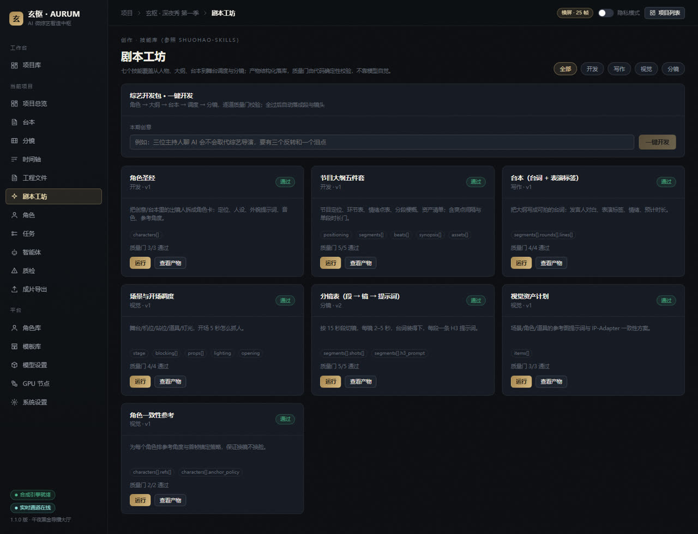
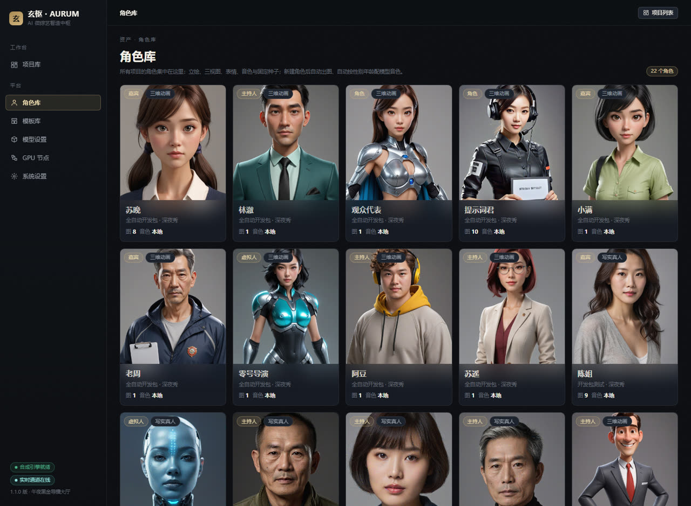
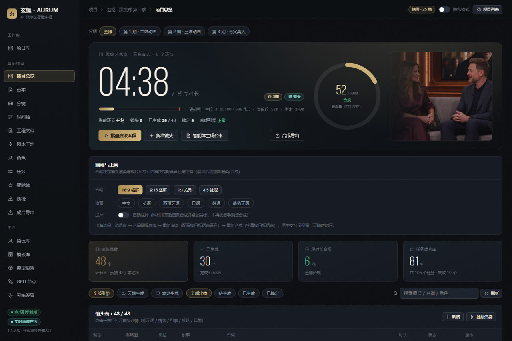

# 玄枢 · AURUM

> **AI 微综艺智造中枢**：一句创意或一份台本进去，出来的是一季可播的节目——剧本工坊、角色、配音、分镜、渲染、字幕花字、成片导出。



## 这是什么

玄枢是一套面向**综艺/脱口秀**的 AI 生产平台（不是通用剪辑器）：

- **剧本工坊**：7 个带确定性质量门的技能（角色圣经 / 节目大纲 / 台本 / 舞台调度 / 分镜表 / 视觉资产 / 角色一致性），产物结构化入库、可版本化、可一键落回台本；
- **多期**：一个项目是一季，季下多期，每期独立模板 / 画风 / 语言；
- **角色**：LLM 读人设推断性别年龄音色 → 本地 Breeze TTS 2 绑定音色；本机 SDXL 自动出立绘、三视图、表情；
- **双引擎渲染**：云端 Muse / 本地 ComfyUI H3 可切换，中景与全景自动 2–3 人同框；
- **包装**：ASS 字幕、立体花字（PNG 合成 + 滑入动效）、调色与暗角、片头片尾；
- **工程文件**：每期自动沉淀工程（台词/词锚/分镜/媒体轨/槽位），可复刻、可批量复刻、可抽象成模板；
- **成片**：队列排空自动合成、按「项目名-vN.mp4」归档、导出历史可回溯。



## 快速开始

环境：**Node 22+ / pnpm 10+**（Windows / macOS / Linux），FFmpeg 由依赖自带（ffmpeg-static）。

```bash
pnpm install
pnpm dev            # 中台 :8787（API + Web），开发态前端 :5273（Vite 代理 /api）
# 或者：构建前端后由中台单进程托管
pnpm build
pnpm serve          # http://127.0.0.1:8787
```

Windows 一键启停（含 ComfyUI、Breeze TTS 检测）：

```powershell
.\start.ps1   # 启动中台 + 渲染 + 音色服务检测
.\stop.ps1
```

首次启动会自动建库并种入示例项目、模板与预设。**不配任何 Key 也能跑通**：未配置文本模型时走规则引擎，未接 GPU 时由 FFmpeg 生成可播放的代理片。

## 配置

密钥与模型配置都在平台「模型设置 / 系统设置」里，落库，不写在代码里。

| 变量 | 说明 |
|---|---|
| `AURUM_DATA_DIR` | 数据根目录（SQLite、资产、导出），默认 `./.data` |
| `BREEZE_TTS_URL` | 本地 Breeze TTS 2 服务，默认 `http://127.0.0.1:7861` |
| `COMFYUI_URL` | 本地 ComfyUI，默认 `http://127.0.0.1:8188` |
| `CHROME_PATH` | 花字 PNG 渲染用的 Chrome |

云端视频走 APIMart Muse（`muse-video-ext`，720p、10s/段），在「模型设置」里填 Key；本地视频走 ComfyUI 工作流。两者可同时启用，按镜头引擎字段选择。

## 架构

```
web (React 18 + Vite)          ── 项目 / 台本 / 分镜 / 时间轴 / 剧本工坊 / 角色 / 模板 / 工程 / 成片
services/api (Fastify 5)       ── REST + WebSocket，SQLite（node:sqlite），任务调度器
  ├─ domain/                   ── 技能、工程文件、多期、角色自动配置、合规
  ├─ adapters/                 ── muse(云端) / comfy(本地) / tts(edge+breeze) / translate / compose
  ├─ media/                    ── ffmpeg、ASS 字幕、立体花字、WAV/BGM
  └─ scheduler/                ── tts → video → lipsync 的 DAG，重试与降级
packages/core                  ── 共享类型与常量
```

任务链路：`tts → video(cloud|local) → lipsync`，合成任务独立；队列排空后按项目 `auto_compose` 自动出片。

## 功能状态

| 能力 | 状态 |
|---|---|
| 剧本工坊 7 技能 + 质量门 + 版本化 | ✅ |
| 一键开发包（技能串成流水线，过门后落段/镜） | ✅ |
| 多期（季 → 期，独立画风/语言/模板） | ✅ |
| 角色自动立绘 / 三视图 / 表情 + Breeze 音色 | ✅ |
| 云端 + 本地双引擎、2–3 人同框 | ✅ |
| 字幕 / 立体花字 / 动效 / 调色 | ✅（花字规则仍在打磨） |
| 工程文件、复刻、批量复刻、抽象模板 | ✅ |
| 自动成片 + 归档 + 导出历史 | ✅ |
| 模板库（16 综艺形态 + 13 工作流/参数/配音/工程） | ✅ |



## 当前限制（如实写）

1. **花字与剪辑仍是脚本级**：位置/字号规则、避让、转场还在迭代；复杂包装建议接 Remotion；
2. **画面可能带模型生成的背景文字**：提示词已加 `no text / no signage`，但云端模型不保证；
3. **单段硬上限 300 秒**：长节目靠多段拼接；
4. **渲染依赖**：云端需要 APIMart Key，本地需要 8GB+ 显存与 ComfyUI 模型；
5. 本地 Breeze TTS 首次加载约 1–2 分钟，显存与 ComfyUI 需错峰。

## 目录

```
web/            前端（中文 UI）
services/api/   中台：路由、领域服务、适配器、媒体、调度
services/agent/ 智能体服务
packages/core/  共享类型
workflows/      ComfyUI / H3 工作流
docs/           架构、API、错误码、设计系统、截图
```

## 致谢

- 剧本技能的方法论参考 [shuohao-skills](https://github.com/eternityspring/shuohao-skills)（小说→短剧的七技能与确定性质量门），本项目将其改造为综艺/台本语境；
- 角色一致性、Breeze TTS、MuseTalk 口型的本地工程实践来自同机的 AiJue 项目；
- 云端视频：APIMart `muse-video-ext`；本地：ComfyUI + SDXL + H3。

## License

[Apache-2.0](LICENSE)
